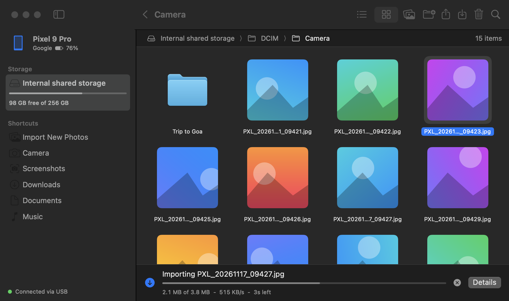
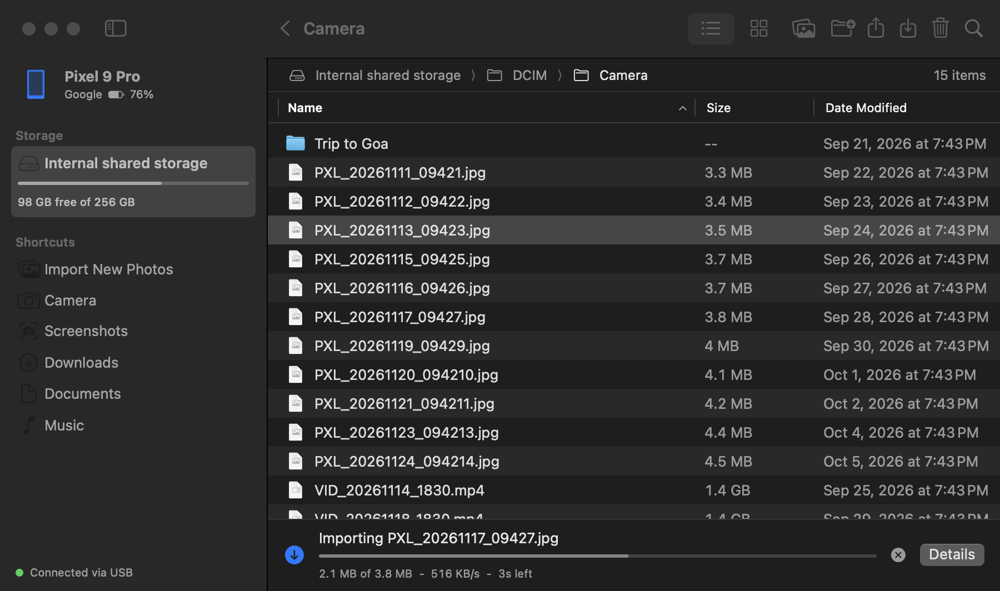

# Sideport: Android File Transfer for Mac (Apple Silicon)

**A free, open-source, native Apple Silicon app for transferring files between an Android phone and a Mac over USB.**
It replaces Google's discontinued Android File Transfer, which is Intel-only and runs on M1, M2, M3, M4 and M5 Macs
only through Rosetta. Sideport is a 1.4 MB SwiftUI app with no Rosetta and no Electron. It runs on macOS 14 Sonoma and later.

[Download for Mac](https://github.com/a-kash-singh/Sideport/releases/latest) |
[Website](https://a-kash-singh.github.io/Sideport/) |
`brew install --cask a-kash-singh/tap/sideport`



## Features

- **Native Apple Silicon (arm64)** SwiftUI app. Small, fast, and it looks and works like Finder.
- **Photo thumbnails:** browse DCIM/Camera as a grid of previews. The previews come from the phone, so photos are not downloaded just to see them.
- **Import New Photos:** one click copies only the photos and videos you have not imported before (from DCIM and Screenshots) into a Mac folder. Run it again and it skips what is already there. Copies keep the date each photo was taken.
- **Quick Look:** press Space or Cmd+Y to preview a photo, video or document from the phone.
- **Drag and drop both ways** between Finder and the phone, including whole folders.
- **Files larger than 4 GB** transfer correctly. Android File Transfer could not copy them.
- **Transfer queue** with progress, speed and time remaining, plus Cancel All. The Mac does not idle-sleep during transfers.
- **Automatic connection:** Sideport finds the phone when it is plugged in, reconnects after a replug, and waits while the phone is locked.
- **Fixes "phone not detected":** Sideport releases the phone from macOS Image Capture (`ptpcamerad`), which often grabs Android phones first.
- Shows internal storage and SD cards with free space, and the battery level.
- New folder, rename and delete. Filter by name and sort by name, size or date. Breadcrumb path bar, plus shortcuts to Camera, Screenshots, Downloads, Documents and Music.



## Install

**Homebrew**

```sh
brew install --cask a-kash-singh/tap/sideport
```

**Manual:** download `Sideport-arm64.zip` from [Releases](https://github.com/a-kash-singh/Sideport/releases/latest)
and move `Sideport.app` to Applications. The app is ad-hoc signed, not notarized. On first launch, right-click it and
choose Open, or run `xattr -dr com.apple.quarantine /Applications/Sideport.app`.

Then plug in the phone, unlock it, and choose **File transfer** in the USB notification.

## Keyboard shortcuts

| Action | Shortcut |
| --- | --- |
| Quick Look | Space or Cmd+Y |
| Import New Photos | Cmd+I |
| Upload files | Cmd+O |
| New folder | Cmd+Shift+N |
| List / thumbnails | Cmd+1 / Cmd+2 |
| Enclosing folder | Cmd+Up |
| Delete | Delete |
| Refresh | Cmd+R |
| Show hidden files | Cmd+Shift+. |

## FAQ

**How do I transfer files from an Android phone to a Mac with an M1, M2, M3 or M4 chip?**
Install Sideport, connect the phone with a USB cable, unlock it and pick "File transfer" in the USB notification.
Sideport opens the phone's storage. Drag files into Finder, or use Import New Photos.

**Does Android File Transfer work on Apple Silicon?**
Google's Android File Transfer only runs through Rosetta 2, is no longer offered by Google, and cannot copy files over 4 GB.
Sideport is built natively for Apple Silicon.

**Android File Transfer says "Could not connect to device" or "No Android device found". What do I do?**
Unlock the phone and choose "File transfer" (MTP), not "Charging only". Use a data cable, because many cables carry
charge only. Quit other apps that use the phone (Android File Transfer, OpenMTP, Image Capture, Photos). Sideport
releases the phone from Image Capture automatically.

**How is Sideport different from OpenMTP?**
OpenMTP is a great, mature project with more options, such as two-pane browsing. Sideport is a much smaller native
SwiftUI app, and adds photo thumbnails, one-click import of new photos and Quick Look. Use whichever suits you.

**Does it need Wi-Fi, an account or an app on the phone?**
No. It works over USB using MTP, the protocol Android already uses for file transfer.

**Does it work on Intel Macs?**
Releases are built for Apple Silicon. Intel Macs can build it from source.

## Build from source

```sh
brew install libmtp pkgconf
swift run                 # dev build, links Homebrew's libmtp
scripts/package.sh        # self-contained build/Sideport.app + zip
```

`package.sh` builds libusb and libmtp from source for macOS 14+ (pinned and checksummed), bundles them in the app
and ad-hoc signs it.

## License

MIT. Sideport dynamically links [libmtp](https://github.com/libmtp/libmtp) and
[libusb](https://github.com/libusb/libusb), both LGPL-2.1. Their unmodified sources are fetched by
`scripts/build-deps.sh`.

Android is a trademark of Google LLC. Sideport is not affiliated with or endorsed by Google.
